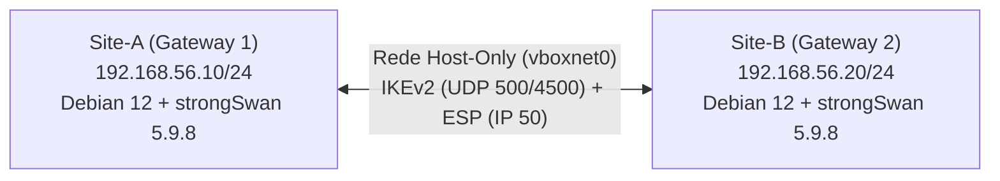

# Relatório Técnico — Apresentação Prática de IPsec (IKEv2 / ESP)

### Nome: Bruno Antonio dos Santos Bezerra
### Login: basb
### Disciplina: IF738 — Redes de Computadores

---

## 1. Objetivo

Configurar e demonstrar na prática uma **VPN Site-to-Site utilizando IPsec (IKEv2 + ESP em modo túnel)** entre duas máquinas virtuais Linux (`Site-A` e `Site-B`) com o daemon **strongSwan**, analisando no **Wireshark/tshark** o handshake de negociação IKEv2, o encapsulamento cifrado em ESP e a instalação das *Security Associations* (SAs) no subsistema XFRM do Kernel Linux.

---

## 2. Arquitetura e Topologia de Rede



- **Hipervisor:** VirtualBox (rede *Host-Only* `192.168.56.0/24`, adaptador `vboxnet0`).
- **Sistema Operacional das VMs:** Debian 12 (Bookworm) em modo texto (`multi-user.target`), com `strongswan`, `strongswan-starter`, `openssh-server` e `tcpdump`.
- **Gateways:**
  - **Site-A:** `192.168.56.10` (`enp0s3`)
  - **Site-B:** `192.168.56.20` (`enp0s3`)
- **Algoritmos negociados:**
  - **IKEv2 (Plano de Controle):** `AES_CBC_256` + `HMAC_SHA2_256_128` + `PRF_HMAC_SHA2_256` + `MODP_2048` (Diffie-Hellman Grupo 14), autenticação via **PSK** (*Pre-Shared Key*).
  - **ESP (Plano de Dados):** `AES_CBC_256` + `HMAC_SHA2_256_128`, **Modo Túnel**.

> **Nota sobre o repositório:** As imagens exportadas das VMs (`Site-A.ova` e `Site-B.ova`, ~3,3 GB cada) não são versionadas no Git por excederem o limite de tamanho do GitHub. Todos os arquivos de configuração necessários para reproduzir o ambiente estão disponíveis em [`configs/`](configs/) e a captura de pacotes real está em [`capturas/ipsec_demo.pcapng`](capturas/ipsec_demo.pcapng).

---

## 3. Arquivos de Configuração (strongSwan)

- [`configs/site-a-ipsec.conf`](configs/site-a-ipsec.conf) — configuração `/etc/ipsec.conf` do **Site-A** (`left=192.168.56.10`, `right=192.168.56.20`, `type=tunnel`, `auto=add`).
- [`configs/site-b-ipsec.conf`](configs/site-b-ipsec.conf) — configuração `/etc/ipsec.conf` do **Site-B** (`left=192.168.56.20`, `right=192.168.56.10`, `type=tunnel`, `auto=add`).
- [`configs/ipsec.secrets.example`](configs/ipsec.secrets.example) — modelo do arquivo `/etc/ipsec.secrets` com a chave pré-compartilhada (permissão `chmod 600`).

O parâmetro `auto=add` foi escolhido propositalmente para carregar a política sem estabelecer o túnel automaticamente no boot, permitindo disparar a negociação ao vivo via `sudo ipsec up site-to-site` e encerrá-la via `sudo ipsec down site-to-site`.

---

## 4. Captura e Análise de Pacotes (`ipsec_demo.pcapng`)

A captura real do enlace virtual ([`capturas/ipsec_demo.pcapng`](capturas/ipsec_demo.pcapng)) registra o ciclo completo do túnel IPsec no meio físico (sem tráfego SSH administrativo):

```text
    1   0.000000  192.168.56.10 → 192.168.56.20  IKE  506  IKE_SA_INIT MID=00 Initiator Request
    2   0.013991  192.168.56.20 → 192.168.56.10  IKE  514  IKE_SA_INIT MID=00 Responder Response
    3   0.033507  192.168.56.10 → 192.168.56.20  IKE  350  IKE_AUTH MID=01 Initiator Request
    4   0.179781  192.168.56.20 → 192.168.56.10  IKE  302  IKE_AUTH MID=01 Responder Response
    5   1.054298  192.168.56.10 → 192.168.56.20  ESP  170  ESP (SPI=0xc546139d)
    6   1.054719  192.168.56.20 → 192.168.56.10  ESP  170  ESP (SPI=0xc2f9739d)
    7   2.082018  192.168.56.10 → 192.168.56.20  ESP  170  ESP (SPI=0xc546139d)
    8   2.082751  192.168.56.20 → 192.168.56.10  ESP  170  ESP (SPI=0xc2f9739d)
    9   3.083696  192.168.56.10 → 192.168.56.20  ESP  170  ESP (SPI=0xc546139d)
   10   3.084293  192.168.56.20 → 192.168.56.10  ESP  170  ESP (SPI=0xc2f9739d)
   11   5.072816  192.168.56.10 → 192.168.56.20  IKE  126  INFORMATIONAL MID=02 Initiator Request
   12   5.074429  192.168.56.20 → 192.168.56.10  IKE  126  INFORMATIONAL MID=02 Responder Response
```

### 4.1 Fase 1 — Handshake IKEv2 (Pacotes 1 a 4)
- **Pacotes 1 e 2 (`IKE_SA_INIT`, UDP 500):** `Site-A` e `Site-B` negociam a suíte criptográfica (`AES_CBC_256 / HMAC_SHA2_256_128 / MODP_2048`), trocam valores públicos Diffie-Hellman e *nonces*, derivando as chaves secretas da IKE SA.
- **Pacotes 3 e 4 (`IKE_AUTH`, UDP 4500):** Já protegidos pela chave derivada na troca anterior, os dois gateways se autenticam mutuamente com a PSK e criam a **Child SA** do ESP com um **SPI** exclusivo para cada sentido (`0xc546139d` de saída e `0xc2f9739d` de entrada no Site-A).

### 4.2 Fase 2 — Tráfego Cifrado em ESP (Pacotes 5 a 10)
Com o túnel estabelecido, o comando `ping -c 3 192.168.56.20` recebeu resposta normal na camada de aplicação (`rtt avg = 0,946 ms`, `0% loss`), demonstrando transparência total do IPsec. Na captura de rede, porém, **nenhum pacote ICMP trafegou em texto claro**: todos os 6 pacotes (3 requisições + 3 respostas) apareceram encapsulados em **ESP (Protocolo IP 50)** com tamanho de **170 bytes** (cabeçalho IP externo + cabeçalho ESP + pacote IP/ICMP interno cifrado + *padding* + ICV de integridade).

### 4.3 Inspeção das Security Associations no Kernel Linux (`ipsec statusall` e `ip xfrm state`)
```text
Security Associations (1 up, 0 connecting):
site-to-site[1]: ESTABLISHED, 192.168.56.10...192.168.56.20
site-to-site[1]: IKE proposal: AES_CBC_256/HMAC_SHA2_256_128/PRF_HMAC_SHA2_256/MODP_2048
site-to-site{1}:  INSTALLED, TUNNEL, reqid 1, ESP SPIs: c2f9739d_i c546139d_o
site-to-site{1}:  AES_CBC_256/HMAC_SHA2_256_128, 252 bytes_i (3 pkts), 252 bytes_o (3 pkts)
site-to-site{1}:   192.168.56.10/32 === 192.168.56.20/32
```

### 4.4 Verificação da Decifragem ESP no Wireshark / `tshark`
Fornecendo ao Wireshark/`tshark` as chaves efêmeras da sessão obtidas em `sudo ip xfrm state` para aquela captura (`SPI 0xc546139d` e `SPI 0xc2f9739d`, `AES-CBC-256` e `HMAC-SHA-256-128`), o decodificador valida o ICV e revela exatamente os pacotes ICMP protegidos dentro do ESP:

```text
    5   1.054298  192.168.56.10 → 192.168.56.20  ICMP  170  Echo (ping) request  id=0x0310, seq=1/256, ttl=64
    6   1.054719  192.168.56.20 → 192.168.56.10  ICMP  170  Echo (ping) reply    id=0x0310, seq=1/256, ttl=64 (request in 5)
    7   2.082018  192.168.56.10 → 192.168.56.20  ICMP  170  Echo (ping) request  id=0x0310, seq=2/512, ttl=64
    8   2.082751  192.168.56.20 → 192.168.56.10  ICMP  170  Echo (ping) reply    id=0x0310, seq=2/512, ttl=64 (request in 7)
    9   3.083696  192.168.56.10 → 192.168.56.20  ICMP  170  Echo (ping) request  id=0x0310, seq=3/768, ttl=64
   10   3.084293  192.168.56.20 → 192.168.56.10  ICMP  170  Echo (ping) reply    id=0x0310, seq=3/768, ttl=64 (request in 9)
```

### 4.5 Fase 3 — Encerramento Seguro do Túnel (Pacotes 11 e 12)
Ao executar `sudo ipsec down site-to-site`, os gateways trocam uma mensagem cifrada **`INFORMATIONAL` (DELETE)** removendo a IKE SA e as SAs do kernel de forma coordenada.

---

## 5. Materiais Complementares

- **Slides da apresentação:** [`IPsec (IKEv2 ESP).pdf`](IPsec%20(IKEv2%20ESP).pdf)
- **Roteiro prático e guia de demonstração:** [`roteiro_apresentacao_ipsec.md`](roteiro_apresentacao_ipsec.md)
- **Captura Wireshark:** [`capturas/ipsec_demo.pcapng`](capturas/ipsec_demo.pcapng)
