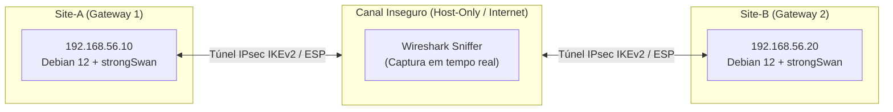

# Guia Completo: Apresentação Prática de IPsec (IKEv2 / ESP)
**Disciplina:** Redes de Computadores (2026-2) — Prof. Djamel Sadok  
**Aluno:** Bruno Bezerra  
**Tema:** IPsec (IKEv2/ESP) com strongSwan e Wireshark  
**Duração:** ~20 minutos  

---

## 1. Conteúdo dos 2 Slides de Introdução

O professor exige apenas **1 ou 2 slides** para introduzir o tema e explicar o que será visto na demonstração. Você pode copiar o conteúdo abaixo diretamente para o PowerPoint, Google Slides ou Canva.

```carousel
### SLIDE 1: Fundamentos do IPsec (IKEv2 + ESP)

**O que é o IPsec?**
* Conjunto de protocolos de segurança que opera na **Camada de Rede (L3)**, garantindo **confidencialidade**, **integridade** e **autenticação** transparente para aplicações.

**A Arquitetura em Duas Fases:**
1. **Plano de Controle — IKEv2 (Porta UDP 500 / 4500):**
   * Negociação de algoritmos criptográficos (AES, SHA) e troca de chaves Diffie-Hellman (`IKE_SA_INIT`).
   * Autenticação mútua via Chave Pré-Compartilhada (PSK) ou certificados digitais (`IKE_AUTH`).
   * Cria as **SAs (Security Associations)**.
2. **Plano de Dados — ESP (Protocolo IP 50):**
   * Encapsula e criptografa a carga útil da rede (payload + cabeçalho IP interno).
   * Identificado pelo **SPI (Security Parameters Index)** no cabeçalho.

**Modo Túnel vs. Modo Transporte:**
* **Modo Túnel (Utilizado no Demo):** Cifra todo o pacote IP original e adiciona um novo cabeçalho externo. Essencial para VPNs *Site-to-Site* entre redes distintas.
<!-- slide -->
### SLIDE 2: Topologia e Roteiro da Demonstração Prática



**Roteiro da Demonstração (Ao Vivo):**
1. **Tráfego sem Proteção:** Envio de pacotes `ping` (ICMP) com o túnel desativado $\rightarrow$ Wireshark expõe todo o payload em texto claro.
2. **Estabelecimento do Túnel:** Execução do comando do strongSwan $\rightarrow$ Captura das 4 etapas do handshake **IKEv2** (`IKE_SA_INIT` e `IKE_AUTH`).
3. **Tráfego Protegido:** Novo envio de pacotes $\rightarrow$ O ICMP desaparece; no fio trafega apenas **ESP (Protocolo 50)** com 170 bytes e SPIs de sessão.
4. **Inspeção de Kernel:** Exibição das Security Associations instaladas no Kernel do Linux via `ip xfrm state`.
```

---

## 2. Roteiro Cronometrado da Apresentação (20 Minutos)

| Tempo | Etapa | Ação na Prática | O que falar para o professor e a turma |
| :--- | :--- | :--- | :--- |
| **00:00 - 04:00** | **Slides (Teoria)** | Exibir Slide 1 e Slide 2 | Explicar que o IPsec opera na Camada 3 de forma transparente, o papel do IKEv2 (negociação) vs ESP (cifra) e a topologia com duas VMs no VirtualBox. |
| **04:00 - 07:00** | **Tráfego Aberto** | 1. No Wireshark, filtro `icmp \|\| isakmp \|\| esp`<br>2. No Site-A: `ping -c 3 192.168.56.20` | *"Vejam que antes da VPN, o pacote ICMP viaja vulnerável. Qualquer invasor no meio do caminho consegue ler a carga útil dos dados."* |
| **07:00 - 12:00** | **Handshake IKEv2** | No Site-A: `sudo ipsec up site-to-site` | *"Agora acionamos o strongSwan. No Wireshark vemos as 4 mensagens do IKEv2 negociando chaves Diffie-Hellman e autenticando via PSK."* |
| **12:00 - 16:00** | **Tráfego Cifrado (ESP)** | No Site-A: `ping -c 3 192.168.56.20` | *"Com a VPN ativa, o protocolo agora é ESP (IP 50). O cabeçalho ICMP sumiu do tráfego de rede; só vemos o identificador SPI e a carga cifrada com AES-256."* |
| **16:00 - 18:00** | **Auditoria no Kernel** | No Site-A ou Site-B:<br>`sudo ipsec statusall`<br>`sudo ip xfrm state` | *"O strongSwan não faz a criptografia na aplicação: ele instrui o subsistema XFRM do Kernel do Linux a manipular os pacotes em nível de hardware/kernel."* |
| **18:00 - 20:00** | **Dúvidas & Conclusão** | Espaço para perguntas | Responder eventuais perguntas do professor Djamel Sadok. |

---

## 3. Guia de Exportação (Casa) e Importação (Faculdade)

### No seu computador de casa (Linux):

1. **Limpar arquivos desnecessários nas VMs para o arquivo `.ova` ficar leve:**
   Entre em cada VM e rode:
   ```bash
   sudo apt clean
   sudo rm -rf /var/log/*.gz /tmp/*
   ```

2. **Desligar as duas VMs:**
   ```bash
   sudo poweroff
   ```

3. **Exportar as VMs pelo VirtualBox:**
   * No menu do VirtualBox: **Arquivo (File) -> Exportar Appliance... (Export Appliance)**.
   * Selecione as duas máquinas: **`Site-A`** e **`Site-B`**.
   * Escolha o formato: **Open Virtualization Format 2.0** (ou 1.0).
   * Escolha onde salvar (ex.: `ipsec-lab.ova`).
   * Salve no pendrive ou suba no Google Drive. O arquivo final terá por volta de **1 GB**.

---

### No computador da faculdade (Windows):

1. **Importar no VirtualBox do Windows:**
   * Abra o VirtualBox no Windows.
   * Clique em **Arquivo -> Importar Appliance...** e selecione o `ipsec-lab.ova`.
   * Marque a opção: *"Reinicializar o endereço MAC de todas as placas de rede"* (Reinitialize MAC address).
   * Clique em **Importar**.

2. **Garantir a rede Host-Only no Windows:**
   * No VirtualBox do Windows, vá em **Ferramentas -> Rede (Host Network Manager)**.
   * Se já existir um adaptador Host-Only (`VirtualBox Host-Only Ethernet Adapter`), certifique-se de que o IPv4 dele é `192.168.56.1` e a máscara `255.255.255.0`.
   * Nas configurações de rede de cada VM (**Rede -> Adaptador 1**), confirme que está conectado a **Placa exclusiva de hospedeiro** apontando para o adaptador criado, com **Modo Promíscuo: Permitir Tudo**.

3. **Abrir a Captura no Wireshark do Windows:**
   * Ligue as duas VMs (`Site-A` e `Site-B`).
   * Abra o **PowerShell** no Windows e inicie a captura ao vivo:
     ```powershell
     ssh vboxuser@192.168.56.10 "sudo /usr/bin/tcpdump -i any -U -w - not port 22" | & "C:\Program Files\Wireshark\wireshark.exe" -k -i -
     ```
   * *(Ou use o recurso nativo **SSH remote capture (sshdump)** dentro do próprio menu do Wireshark do Windows)*.

---

## 4. Colinha de Terminal (Para ter à mão na hora)

### VM Site-A:
```bash
# Derrubar o túnel (para teste em texto claro):
sudo ipsec down site-to-site

# Ping sem VPN (mostrar ICMP no Wireshark):
ping -c 3 192.168.56.20

# Subir a VPN (mostrar IKEv2 no Wireshark):
sudo ipsec up site-to-site

# Ping com VPN (mostrar ESP no Wireshark):
ping -c 3 192.168.56.20

# Inspecionar status:
sudo ipsec statusall
sudo ip xfrm state
```

### Filtros essenciais para colar no Wireshark:
* Para ver tudo: `icmp || isakmp || esp`
* Para ver só a negociação: `isakmp`
* Para ver só o tráfego criptografado: `esp`

---

## 5. Perguntas Prováveis do Professor e Como Responder

> **Pergunta:** *"Por que usar IKEv2 em vez de IKEv1?"*  
> **Resposta:** *"O IKEv2 reduz drasticamente o número de trocas de mensagens (apenas 4 mensagens no handshake inicial contra 6 a 9 no IKEv1), suporta nativamente NAT-Traversal, tem menor latência e maior confiabilidade contra ataques DoS através de cookies criptográficos."*

> **Pergunta:** *"O que é esse SPI que aparece no cabeçalho ESP?"*  
> **Resposta:** *"SPI significa Security Parameters Index (Identificador de Parâmetros de Segurança). É um número arbitrário de 32 bits que o kernel usa como índice em uma tabela para saber qual chave e algoritmo deve usar para decifrar aquele pacote específico."*

> **Pergunta:** *"Por que no Wireshark do Site-A o pacote ICMP de resposta aparece no mesmo nanossegundo que o pacote ESP?"*  
> **Resposta:** *"Porque o pacote viaja na rede física 100% cifrado como ESP com 170 bytes. Quando a placa de rede do Site-A recebe o ESP, o subsistema XFRM do Kernel Linux o decifra imediatamente para entregar a resposta ao comando ping. Como o tcpdump escuta os sockets em nível de kernel, ele vê o pacote físico entrando (ESP) e o pacote decifrado sendo entregue à CPU (ICMP)."*
