# Relatório de Atividade Prática - Mininet

### Nome: Bruno Antonio dos Santos Bezerra
### Login: basb

## Objetivo
Criar e configurar uma topologia de rede complexa utilizando o Mininet, com múltiplos roteadores e sub-redes, garantindo que todos os hosts em diferentes redes possam se comunicar entre si por meio de roteamento estático.

---

## 1. Descrição da Topologia

### 1.1 Visualização da Topologia

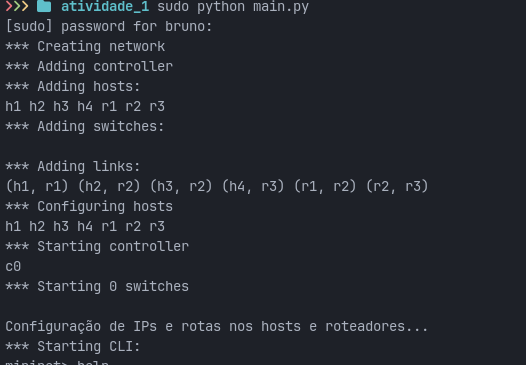

A topologia criada consiste em:
- **4 Hosts**: h1, h2, h3, h4
- **3 Roteadores**: r1, r2, r3
- **4 Sub-redes (LANs)**: LAN1, LAN2, LAN3, LAN4
- **2 Links de interconexão**: Link r1-r2, Link r2-r3

### 1.2 Interfaces de Rede Configuradas

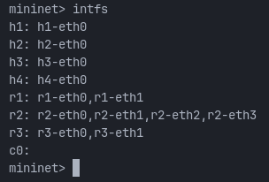

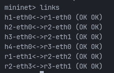

### 1.3 Configuração de IPs em Cada Dispositivo

#### Host h1
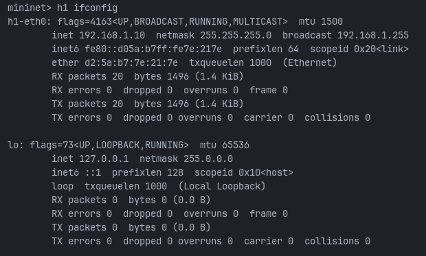

**IP**: 192.168.1.10/24 (LAN1)  
**Gateway**: 192.168.1.1 (r1)

#### Host h2
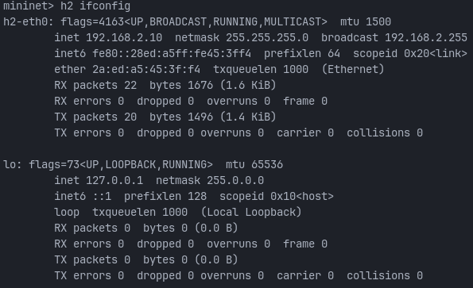

**IP**: 192.168.2.10/24 (LAN2)  
**Gateway**: 192.168.2.1 (r2)

#### Host h3
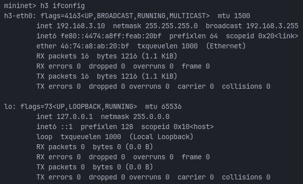

**IP**: 192.168.3.10/24 (LAN3)  
**Gateway**: 192.168.3.1 (r2)

#### Host h4
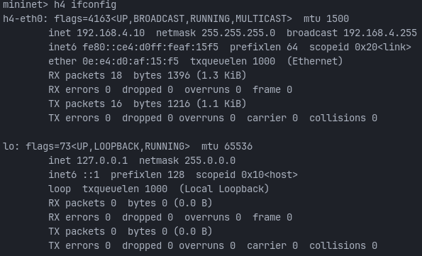

**IP**: 192.168.4.10/24 (LAN4)  
**Gateway**: 192.168.4.1 (r3)

#### Roteador r1
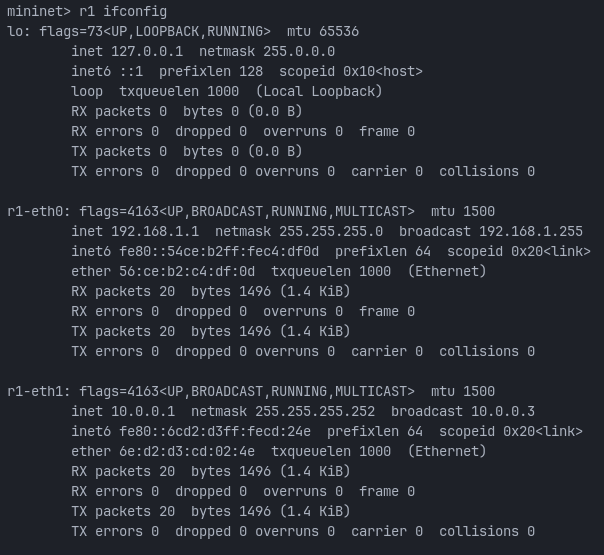

- **r1-eth0**: 192.168.1.1/24 (LAN1)
- **r1-eth1**: 10.0.0.1/30 (Link r1-r2)

#### Roteador r2
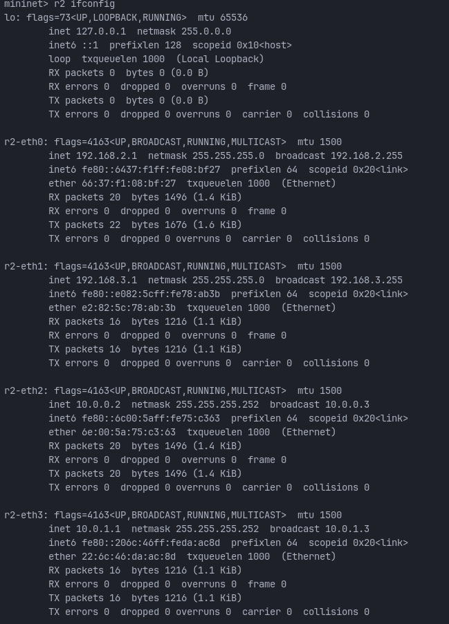

- **r2-eth0**: 192.168.2.1/24 (LAN2)
- **r2-eth1**: 192.168.3.1/24 (LAN3)
- **r2-eth2**: 10.0.0.2/30 (Link r1-r2)
- **r2-eth3**: 10.0.1.1/30 (Link r2-r3)

#### Roteador r3
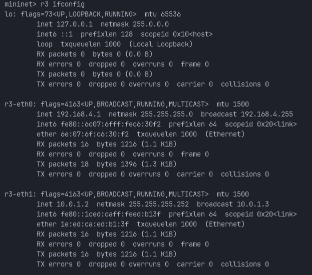

- **r3-eth0**: 192.168.4.1/24 (LAN4)
- **r3-eth1**: 10.0.1.2/30 (Link r2-r3)

---

## 2. Configuração

### 2.1 Código Python da Topologia

#### Arquivo: minha_topologia.py

```python
from mininet.topo import Topo

class MyTopo(Topo):
    def build(self):
        # Hosts
        h1 = self.addHost('h1')
        h2 = self.addHost('h2')
        h3 = self.addHost('h3')
        h4 = self.addHost('h4')

        # Roteadores
        r1 = self.addHost('r1')
        r2 = self.addHost('r2')
        r3 = self.addHost('r3')

        # Conexões entre hosts e roteadores
        self.addLink(h1, r1)

        self.addLink(h2, r2)
        self.addLink(h3, r2)

        self.addLink(h4, r3)

        # Conexões entre roteadores
        self.addLink(r1, r2)
        self.addLink(r2, r3)
```

#### Arquivo: main.py

```python
#!/usr/bin/env python3

from mininet.net import Mininet
from mininet.cli import CLI
from mininet.log import setLogLevel

from minha_topologia import MyTopo

def run():
    topo = MyTopo()
    net = Mininet(topo=topo)
    net.start()

    print("Configuração de IPs e rotas nos hosts e roteadores...")

    # Configuração de IPs nos hosts
    h1 = net.get('h1')
    h1.setIP('192.168.1.10/24', intf='h1-eth0')
    h2 = net.get('h2')
    h2.setIP('192.168.2.10/24', intf='h2-eth0')
    h3 = net.get('h3')
    h3.setIP('192.168.3.10/24', intf='h3-eth0')
    h4 = net.get('h4')
    h4.setIP('192.168.4.10/24', intf='h4-eth0')

    # Configuração de IPs nos roteadores
    r1 = net.get('r1')
    r1.setIP('192.168.1.1/24', intf='r1-eth0')
    r1.setIP('10.0.0.1/30', intf='r1-eth1')

    r2 = net.get('r2')
    r2.setIP('192.168.2.1/24', intf='r2-eth0')
    r2.setIP('192.168.3.1/24', intf='r2-eth1')
    r2.setIP('10.0.0.2/30', intf='r2-eth2')
    r2.setIP('10.0.1.1/30', intf='r2-eth3')

    r3 = net.get('r3')
    r3.setIP('192.168.4.1/24', intf='r3-eth0')
    r3.setIP('10.0.1.2/30', intf='r3-eth1')

    # Habilitar o encaminhamento de pacotes nos roteadores
    r1.cmd('sysctl -w net.ipv4.ip_forward=1')
    r2.cmd('sysctl -w net.ipv4.ip_forward=1')
    r3.cmd('sysctl -w net.ipv4.ip_forward=1')

    # Configurar rotas estáticas para comunicação entre todas as sub-redes
    r1.cmd('ip route add 192.168.2.0/24 via 10.0.0.2')
    r1.cmd('ip route add 192.168.3.0/24 via 10.0.0.2')
    r1.cmd('ip route add 192.168.4.0/24 via 10.0.0.2')
    r1.cmd('ip route add 10.0.1.0/30 via 10.0.0.2')

    r2.cmd('ip route add 192.168.1.0/24 via 10.0.0.1')
    r2.cmd('ip route add 192.168.4.0/24 via 10.0.1.2')

    r3.cmd('ip route add 192.168.1.0/24 via 10.0.1.1')
    r3.cmd('ip route add 192.168.2.0/24 via 10.0.1.1')
    r3.cmd('ip route add 192.168.3.0/24 via 10.0.1.1')
    r3.cmd('ip route add 10.0.0.0/30 via 10.0.1.1')

    # Configurar rotas padrão nos hosts
    h1.cmd('ip route add default via 192.168.1.1')
    h2.cmd('ip route add default via 192.168.2.1')
    h3.cmd('ip route add default via 192.168.3.1')
    h4.cmd('ip route add default via 192.168.4.1')

    CLI(net)
    net.stop()

if __name__ == '__main__':
    setLogLevel('info')
    run()
```

### 2.2 Comandos Utilizados para Configuração

#### Configuração de IPs nas Interfaces
```bash
# Hosts
ifconfig h1-eth0 192.168.1.10/24
ifconfig h2-eth0 192.168.2.10/24
ifconfig h3-eth0 192.168.3.10/24
ifconfig h4-eth0 192.168.4.10/24

# Roteador r1
ifconfig r1-eth0 192.168.1.1/24
ifconfig r1-eth1 10.0.0.1/30

# Roteador r2
ifconfig r2-eth0 192.168.2.1/24
ifconfig r2-eth1 192.168.3.1/24
ifconfig r2-eth2 10.0.0.2/30
ifconfig r2-eth3 10.0.1.1/30

# Roteador r3
ifconfig r3-eth0 192.168.4.1/24
ifconfig r3-eth1 10.0.1.2/30
```

#### Habilitar Encaminhamento IP
```bash
# Em cada roteador
sysctl -w net.ipv4.ip_forward=1
```

#### Adicionar Rotas Estáticas
```bash
# Roteador r1
ip route add 192.168.2.0/24 via 10.0.0.2
ip route add 192.168.3.0/24 via 10.0.0.2
ip route add 192.168.4.0/24 via 10.0.0.2
ip route add 10.0.1.0/30 via 10.0.0.2

# Roteador r2
ip route add 192.168.1.0/24 via 10.0.0.1
ip route add 192.168.4.0/24 via 10.0.1.2

# Roteador r3
ip route add 192.168.1.0/24 via 10.0.1.1
ip route add 192.168.2.0/24 via 10.0.1.1
ip route add 192.168.3.0/24 via 10.0.1.1
ip route add 10.0.0.0/30 via 10.0.1.1

# Hosts
ip route add default via 192.168.1.1  # h1
ip route add default via 192.168.2.1  # h2
ip route add default via 192.168.3.1  # h3
ip route add default via 192.168.4.1  # h4
```

---

## 3. Rotas Estáticas

### 3.1 Tabela de Rotas por Roteador

#### Roteador r1 (192.168.1.1/24 ↔ 10.0.0.1/30)

| Destino | Via | Interface | Motivo |
|---------|-----|-----------|--------|
| 192.168.2.0/24 (LAN2) | 10.0.0.2 | r1-eth1 | Alcançar hosts em LAN2 |
| 192.168.3.0/24 (LAN3) | 10.0.0.2 | r1-eth1 | Alcançar hosts em LAN3 |
| 192.168.4.0/24 (LAN4) | 10.0.0.2 | r1-eth1 | Alcançar hosts em LAN4 |
| 10.0.1.0/30 (r2-r3) | 10.0.0.2 | r1-eth1 | Alcançar link entre r2 e r3 |

#### Roteador r2 (10.0.0.2/30 ↔ 10.0.1.1/30)

| Destino | Via | Interface | Motivo |
|---------|-----|-----------|--------|
| 192.168.1.0/24 (LAN1) | 10.0.0.1 | r2-eth2 | Alcançar hosts em LAN1 |
| 192.168.4.0/24 (LAN4) | 10.0.1.2 | r2-eth3 | Alcançar hosts em LAN4 via r3 |

#### Roteador r3 (10.0.1.2/30 ↔ 192.168.4.1/24)

| Destino | Via | Interface | Motivo |
|---------|-----|-----------|--------|
| 192.168.1.0/24 (LAN1) | 10.0.1.1 | r3-eth1 | Alcançar hosts em LAN1 via r2 |
| 192.168.2.0/24 (LAN2) | 10.0.1.1 | r3-eth1 | Alcançar hosts em LAN2 via r2 |
| 192.168.3.0/24 (LAN3) | 10.0.1.1 | r3-eth1 | Alcançar hosts em LAN3 via r2 |
| 10.0.0.0/30 (r1-r2) | 10.0.1.1 | r3-eth1 | Alcançar link entre r1 e r2 |

### 3.2 Explicação das Rotas

**Roteador r1**: É a entrada da topologia para LAN1. Todas as outras sub-redes devem ser alcançadas através de r2, portanto todos os destinos conhecidos apontam para o gateway 10.0.0.2.

**Roteador r2**: É o nó central da topologia, conectando LAN1, LAN2, LAN3 e servindo de bridge entre r1 e r3. Possui apenas duas rotas estáticas:
- Uma para LAN1 via r1
- Uma para LAN4 via r3 (pois r3 conecta LAN4)

**Roteador r3**: Conecta as LANs 3 e 4. Todas as outras sub-redes devem ser alcançadas através de r2, portanto todos os destinos conhecidos apontam para o gateway 10.0.1.1.

---

## 4. Testes de Conectividade

### 4.1 Ping h1 ↔ h2 | h1 ↔ h3 | h1 ↔ h4

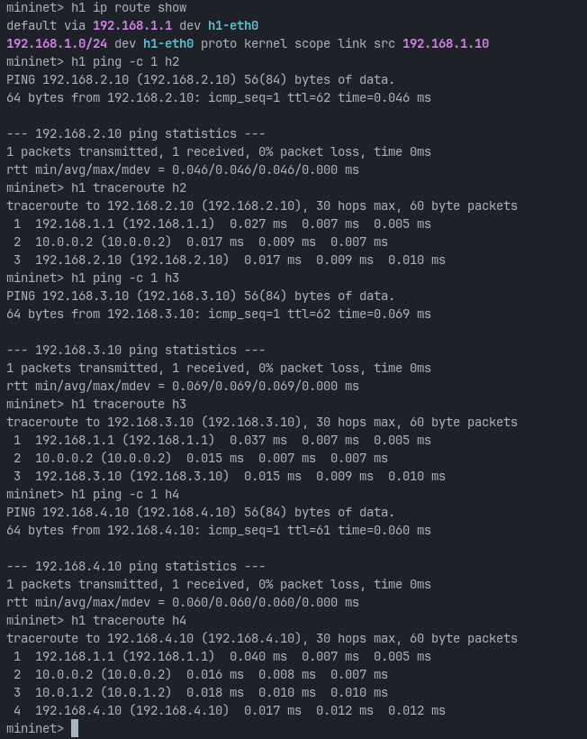

**Resultado**: Sucesso - h1 (192.168.1.10) consegue comunicar com h2 (192.168.2.10)

**Caminho**: h1 → r1 (10.0.0.1) → r2 (10.0.0.2) → h2

---

### 4.2 Ping h2 ↔ h3 | h2 ↔ h4

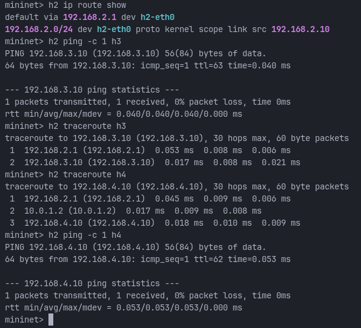

**Resultado**: Sucesso - h2 (192.168.2.10) consegue comunicar com h3 (192.168.3.10)

**Caminho**: h2 → r2 (192.168.2.1) ↔ r2 (192.168.3.1) → h3

---

### 4.3 Ping h3 ↔ h4


**Resultado**: Todos os pings realizados tiveram sucesso, confirmando a conectividade entre as sub-redes.

---

## 5. Conclusão

### 5.1 Dificuldades Encontradas

1. **Configuração correta das rotas estáticas**: Inicialmente, foi necessário entender a topologia e mapear todos os caminhos possíveis entre roteadores e hosts.

2. **Número correto de interfaces**: O roteador r2 precisava de 4 interfaces de rede (eth0, eth1, eth2, eth3) para conectar as duas LANs e os dois links de roteadores.

3. **Habilitação do IP Forward**: O encaminhamento de pacotes deve estar ativo em todos os roteadores para que a comunicação seja possível.

### 5.2 O Que Foi Aprendido

1. **Roteamento estático**: Compreensão profunda de como configurar rotas em roteadores para permitir comunicação entre múltiplas sub-redes.

2. **Arquitetura de redes**: Experiência prática em projetar topologias com múltiplos roteadores e sub-redes.

3. **Mininet e simulação de redes**: Utilização da ferramenta Mininet para criar e testar topologias de rede complexas sem necessidade de hardware real.

4. **Comandos Linux de rede**: Consolidação de conhecimento sobre `ifconfig`, `ip route`, `sysctl` e `ping`.

5. **Python e Mininet API**: Desenvolvimento de scripts Python para automatizar a configuração de topologias de rede.

### 5.3 Sugestões de Melhoria

1. Colocar referências para procurar sobre o ambiente e as bibliotecas necessárias.
