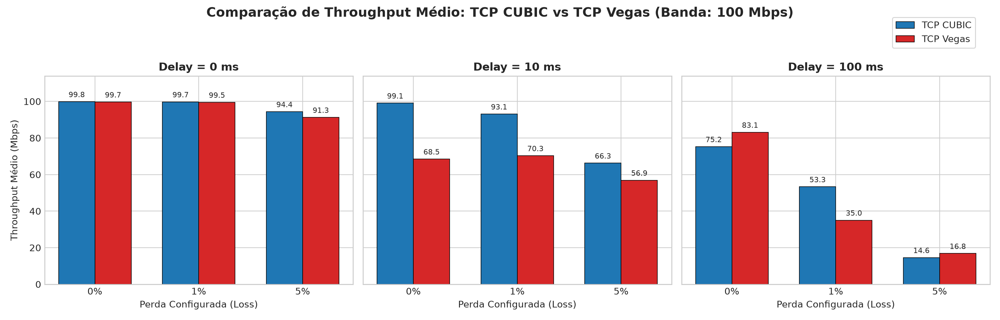
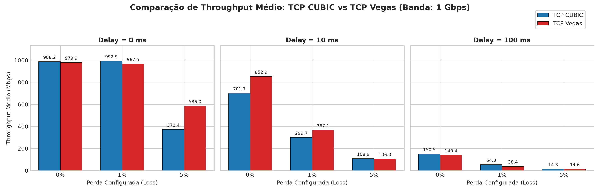
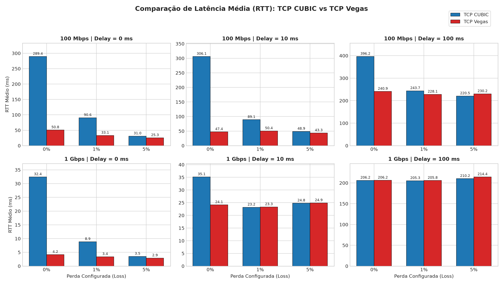
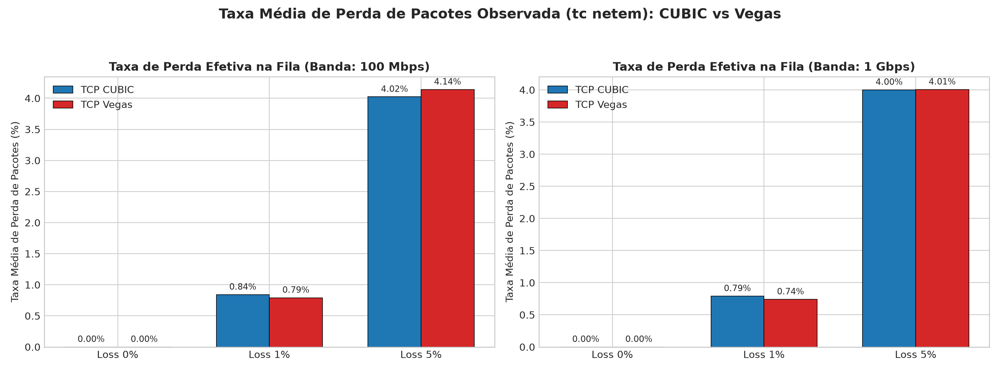
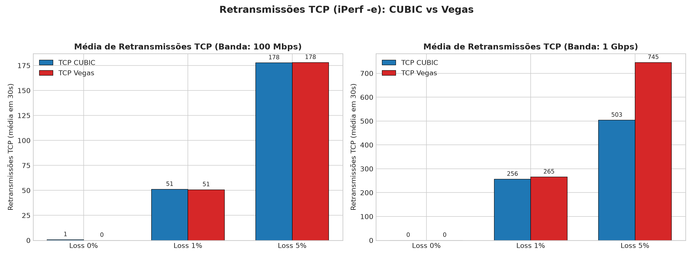
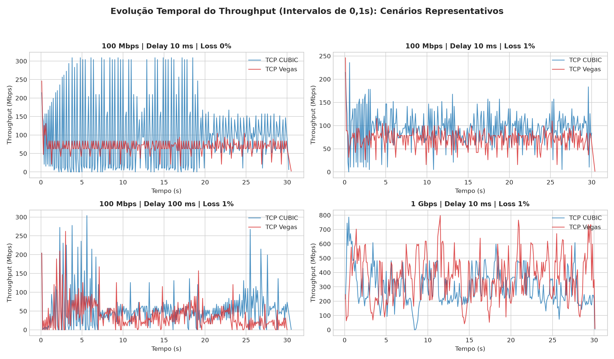
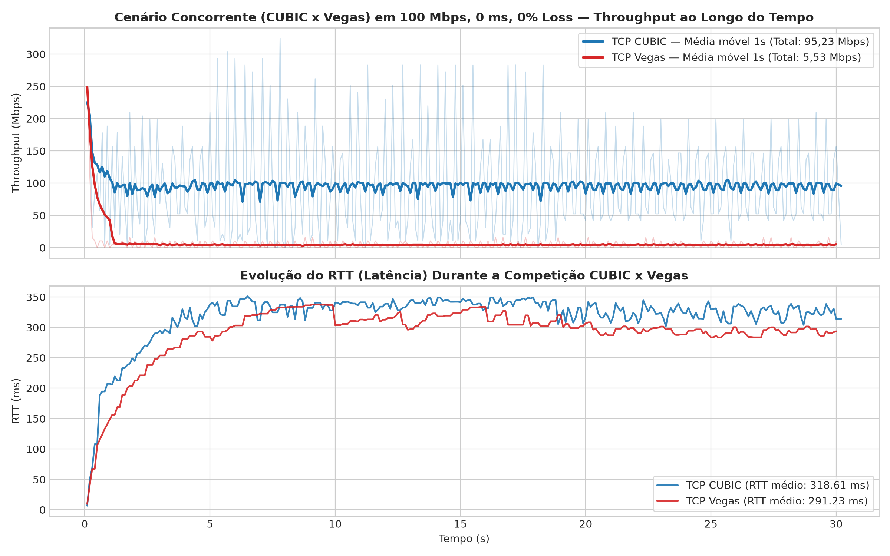

# Relatório de Atividade Prática — Avaliação de Desempenho entre Protocolos de Controle de Congestionamento (TCP CUBIC vs TCP Vegas)

### Nome: Bruno Antonio dos Santos Bezerra
### Login: basb
### Disciplina: IF738 — Redes de Computadores

---

## 1. Objetivo

Avaliar e comparar empiricamente o desempenho de dois algoritmos de controle de congestionamento TCP com filosofias distintas — **TCP CUBIC** (baseado em perdas) e **TCP Vegas** (baseado em atraso) — sob diferentes condições de largura de banda, latência e perda de pacotes, utilizando o **iPerf 2** e o emulador de rede **tc/netem** no Linux, totalizando **37 experimentos** controlados.

---

## 2. Protocolos de Congestionamento Testados

### 2.1 TCP CUBIC (Padrão do Linux)
O **TCP CUBIC** é um algoritmo **baseado em perdas (*loss-based*)** projetado para redes de alto produto banda-atraso (BDP). Ele aumenta sua janela de congestionamento (`cwnd`) segundo uma função cúbica dependente do tempo decorrido desde o último evento de perda ($W(t) = C(t - K)^3 + W_{\max}$), crescendo de forma independente do RTT. Essa característica permite recuperação rápida em enlaces de alta velocidade e longa distância, mas faz com que o algoritmo continue injetando pacotes até preencher completamente os buffers intermediários — induzindo *bufferbloat* (aumento expressivo de latência) antes que ocorra um descarte.

### 2.2 TCP Vegas
O **TCP Vegas** é um algoritmo **baseado em atraso (*delay-based*)** de natureza proativa. Em vez de esperar por descartes de pacotes para detectar congestionamento, o Vegas mede continuamente o menor RTT observado (`BaseRTT`) e compara a taxa esperada ($\text{Expected} = \text{cwnd}/\text{BaseRTT}$) com a taxa efetiva ($\text{Actual} = \text{cwnd}/\text{RTT}$). A partir da diferença $\text{Diff} = (\text{Expected} - \text{Actual}) \times \text{BaseRTT}$ (estimativa de pacotes enfileirados no gargalo) e dos limiares $\alpha$ e $\beta$, ele aumenta a janela quando há poucos pacotes em fila ($\text{Diff} < \alpha$) e a reduz preventivamente quando a fila cresce ($\text{Diff} > \beta$), mantendo baixa latência e menos descartes — porém tornando-se vulnerável quando compete com fluxos *loss-based* agressivos.

---

## 3. Metodologia e Métricas Coletadas

### 3.1 Ambiente e Configuração Experimental
Os testes foram executados via script automatizado ([run_experiments.py](run_experiments.py)) em Linux (kernel 7.3.5) com `iperf` v2.2.1 e módulo `tcp_vegas` carregado via `modprobe tcp_vegas`. Em cada cenário, as condições do enlace foram aplicadas na interface `lo` por meio de `tc qdisc add dev lo root netem`:

- **Bandas (Bandwidth):** `100 Mbps` e `1 Gbps` (`100mbit` e `1000mbit`)
- **Atrasos (Delay):** `0 ms`, `10 ms` e `100 ms` *(nota: na interface `lo`, o atraso de `netem` incide em ambos os sentidos, produzindo RTT base aproximado de `0 ms`, `20 ms` e `200 ms`)*
- **Perdas (Loss):** `0%`, `1%` e `5%`
- **Duração e amostragem:** `-t 30 -i 0.1 -e -y C` (30 segundos por experimento, ~300 amostras de 0,1 s)
- **Cenários:**
  - 18 experimentos individuais para **TCP CUBIC** (`3 × 3 × 2`)
  - 18 experimentos individuais para **TCP Vegas** (`3 × 3 × 2`)
  - 1 experimento concorrente **CUBIC × Vegas** (2 clientes simultâneos em `100 Mbps`, `0 ms` de delay e `0%` de loss)
  - **Total:** `3 × 3 × 2 × 2 + 1 = 37 experimentos`

### 3.2 Explicação das Métricas Coletadas
1. **Largura de Banda (Throughput Médio e Mediano — Mbps):** taxa de transferência efetiva medida pelo `iperf -e -y C` ao longo dos 30 segundos (total agregado e mediana dos intervalos de 0,1 s).
2. **Latência Média (RTT — ms):** tempo médio de ida e volta reportado pela pilha TCP do kernel via coluna `tcprtt` do `iperf -e` (convertido de $\mu\text{s}$ para $\text{ms}$), refletindo a soma do atraso de propagação configurado com o atraso de enfileiramento (*queuing delay*).
3. **Taxa de Perda de Pacotes (%) e Retransmissões TCP:** taxa efetiva de descarte medida diretamente nos contadores do escalonador do kernel (`tc -s qdisc show dev lo`: $\text{dropped} / (\text{sent} + \text{dropped}) \times 100\%$), complementada pelo número total de retransmissões TCP (`tcpretry`) reportadas pelo `iperf -e`.

---

## 4. Tabela Consolidada dos 37 Experimentos

### 4.1 Cenários Individuais — Banda de 100 Mbps (Experimentos 1 a 18)

| # | Algoritmo | Delay (ms) | Loss (%) | Throughput Médio (Mbps) | Throughput Mediano (Mbps) | RTT Médio (ms) | cwnd Média (KB) | Retransmissões TCP | Taxa de Perda `tc` (%) |
| :-: | :--- | :-: | :-: | :-: | :-: | :-: | :-: | :-: | :-: |
| 1 | CUBIC | 0 | 0 | **99,84** | 104,74 | 289,38 | 4146,33 | 0 | 0,00% |
| 2 | Vegas | 0 | 0 | **99,65** | 83,82 | **50,77** | 584,56 | 0 | 0,00% |
| 3 | CUBIC | 0 | 1 | **99,74** | 99,54 | 90,62 | 1154,46 | 66 | 0,89% |
| 4 | Vegas | 0 | 1 | **99,50** | 104,75 | **33,10** | 395,54 | 73 | 0,74% |
| 5 | CUBIC | 0 | 5 | **94,36** | 99,52 | 30,98 | 386,61 | 316 | 4,30% |
| 6 | Vegas | 0 | 5 | 91,25 | 99,52 | **25,29** | 299,01 | 329 | 4,06% |
| 7 | CUBIC | 10 | 0 | **99,07** | 73,34 | 306,11 | 4229,98 | 1 | 0,00% |
| 8 | Vegas | 10 | 0 | 68,47 | 62,86 | **47,37** | 400,38 | 0 | 0,00% |
| 9 | CUBIC | 10 | 1 | **93,09** | 94,29 | 89,10 | 1060,82 | 62 | 0,80% |
| 10 | Vegas | 10 | 1 | 70,29 | 73,36 | **50,45** | 445,24 | 54 | 0,88% |
| 11 | CUBIC | 10 | 5 | **66,25** | 68,08 | 48,86 | 434,30 | 178 | 3,76% |
| 12 | Vegas | 10 | 5 | 56,88 | 57,62 | **43,34** | 334,89 | 172 | 4,07% |
| 13 | CUBIC | 100 | 0 | 75,23 | 10,48 | 396,25 | 4356,68 | 1 | 0,00% |
| 14 | Vegas | 100 | 0 | **83,11** | 89,05 | **240,94** | 2468,52 | 0 | 0,00% |
| 15 | CUBIC | 100 | 1 | **53,30** | 47,14 | 243,75 | 1716,52 | 25 | 0,84% |
| 16 | Vegas | 100 | 1 | 35,04 | 26,19 | **228,07** | 1073,50 | 25 | 0,75% |
| 17 | CUBIC | 100 | 5 | 14,57 | 10,48 | **220,48** | 425,55 | 39 | 4,01% |
| 18 | Vegas | 100 | 5 | **16,82** | 10,48 | 230,16 | 552,40 | 33 | 4,29% |

### 4.2 Cenários Individuais — Banda de 1 Gbps (Experimentos 19 a 36)

| # | Algoritmo | Delay (ms) | Loss (%) | Throughput Médio (Mbps) | Throughput Mediano (Mbps) | RTT Médio (ms) | cwnd Média (KB) | Retransmissões TCP | Taxa de Perda `tc` (%) |
| :-: | :--- | :-: | :-: | :-: | :-: | :-: | :-: | :-: | :-: |
| 19 | CUBIC | 0 | 0 | **988,16** | 1006,62 | 32,42 | 4472,37 | 0 | 0,00% |
| 20 | Vegas | 0 | 0 | 979,85 | 996,14 | **4,16** | 499,94 | 0 | 0,00% |
| 21 | CUBIC | 0 | 1 | **992,93** | 996,14 | 8,86 | 1090,09 | 522 | 0,69% |
| 22 | Vegas | 0 | 1 | 967,54 | 975,17 | **3,40** | 389,80 | 570 | 0,71% |
| 23 | CUBIC | 0 | 5 | 372,36 | 324,86 | 3,53 | 198,25 | 1149 | 4,31% |
| 24 | Vegas | 0 | 5 | **585,96** | 723,51 | **2,91** | 262,23 | 1867 | 4,05% |
| 25 | CUBIC | 10 | 0 | 701,75 | 734,00 | 35,15 | 4324,69 | 0 | 0,00% |
| 26 | Vegas | 10 | 0 | **852,92** | 849,34 | **24,14** | 2476,15 | 0 | 0,00% |
| 27 | CUBIC | 10 | 1 | 299,71 | 262,14 | **23,19** | 838,41 | 214 | 0,82% |
| 28 | Vegas | 10 | 1 | **367,14** | 356,51 | 23,32 | 1023,28 | 201 | 0,69% |
| 29 | CUBIC | 10 | 5 | **108,95** | 104,79 | **24,81** | 327,81 | 315 | 3,99% |
| 30 | Vegas | 10 | 5 | 106,03 | 94,29 | 24,89 | 328,70 | 339 | 4,07% |
| 31 | CUBIC | 100 | 0 | **150,54** | 125,74 | **206,17** | 7902,76 | 0 | 0,00% |
| 32 | Vegas | 100 | 0 | 140,39 | 146,73 | 206,25 | 26631,33 | 0 | 0,00% |
| 33 | CUBIC | 100 | 1 | **53,98** | 41,88 | **205,28** | 1443,77 | 32 | 0,86% |
| 34 | Vegas | 100 | 1 | 38,44 | 31,43 | 205,83 | 996,90 | 25 | 0,83% |
| 35 | CUBIC | 100 | 5 | 14,28 | 10,48 | **210,23** | 403,63 | 46 | 3,70% |
| 36 | Vegas | 100 | 5 | **14,56** | 10,47 | 214,38 | 399,76 | 30 | 3,90% |

### 4.3 Cenário Concorrente — CUBIC × Vegas (Experimento 37: 100 Mbps, 0 ms, 0% Loss)

| Fluxo | Throughput Médio (Mbps) | Throughput Mediano (Mbps) | Participação da Banda | RTT Médio (ms) | cwnd Média (KB) | Retransmissões TCP |
| :--- | :-: | :-: | :-: | :-: | :-: | :-: |
| **TCP CUBIC** | **95,23** | 52,39 | **94,5%** | 318,61 | 4226,30 | 1 |
| **TCP Vegas** | **5,53** | 5,23 | **5,5%** | 291,23 | 163,21 | 2 |

---

## 5. Análise e Interpretação dos Gráficos

### 5.1 Throughput em 100 Mbps e 1 Gbps

- **Baixo atraso e sem perdas (`0 ms, 0%`):** Ambos saturam completamente o enlace (~99,7 Mbps em 100 Mbps e ~980–988 Mbps em 1 Gbps), demonstrando que o Vegas consegue atingir virtualmente a mesma vazão máxima do CUBIC quando o canal é limpo.
- **Efeito do atraso intermediário (`10 ms`) em 100 Mbps vs 1 Gbps:** Em **100 Mbps / 10 ms**, o CUBIC manteve maior vazão (`99,07` vs `68,47 Mbps` em 0% loss; `93,09` vs `70,29 Mbps` em 1% loss) por ser mais agressivo no enchimento do link. Já em **1 Gbps / 10 ms**, o Vegas superou o CUBIC em 0% (`852,92` vs `701,75 Mbps`) e 1% de perda (`367,14` vs `299,71 Mbps`), pois conseguiu estabilizar uma janela elevada com menos oscilações bruscas de fila.
- **Regime severo de alto atraso e alta perda (`100 ms` e `5%`):** O throughput de ambos os protocolos colapsou para a faixa de **14,3–16,8 Mbps** tanto em 100 Mbps quanto em 1 Gbps. Isso confirma o limite teórico de enlaces com alto produto banda-atraso sob perda elevada: com RTT acima de 200 ms e perdas frequentes, o link se torna estritamente limitado pela dinâmica de recuperação de janela TCP (*loss-limited*), tornando irrelevante o aumento de capacidade de 100 Mbps para 1 Gbps.
- **Recuperação em alto atraso com perda moderada (`100 ms, 1%`):** O CUBIC superou o Vegas com folga tanto em 100 Mbps (`53,30` vs `35,04 Mbps`) quanto em 1 Gbps (`53,98` vs `38,44 Mbps`), evidenciando a vantagem da função cúbica de crescimento em redes de longa distância sujeitas a perdas aleatórias.

### 5.2 Latência Média (RTT) e Controle de *Bufferbloat*

Este é o contraste mais expressivo entre as duas abordagens:
- Em **100 Mbps sem perdas (`0%`)**, o CUBIC expandiu `cwnd` para além de **4.100 KB**, enchendo a fila do link e elevando o RTT médio para **289,38 ms** (em delay 0 ms), **306,11 ms** (em delay 10 ms) e **396,25 ms** (em delay 100 ms).
- Nos mesmos cenários, o **TCP Vegas** manteve a fila controlada com RTT de **50,77 ms** (**5,7× menor** em 0 ms), **47,37 ms** (**6,5× menor** em 10 ms) e **240,94 ms** (em 100 ms, próximo ao RTT base de 200 ms).
- Em **1 Gbps / 0 ms / 0%**, o padrão se repetiu: **32,42 ms** no CUBIC contra apenas **4,16 ms** no Vegas (**7,8× menor latência**), mantendo quase 980 Mbps de vazão.
- Quando há perdas (`1%` e `5%`), os descartes forçam o CUBIC a reduzir sua janela frequentemente, esvaziando a fila e aproximando os RTTs dos dois protocolos.

### 5.3 Taxa de Perda de Pacotes e Retransmissões TCP

- As taxas efetivas de perda medidas no `tc netem` acompanharam fielmente os parâmetros configurados (`0%`, `~0,7–0,9%` para 1% e `~3,7–4,3%` para 5%).
- Em cenários sem perda artificial (`0%`), ambos tiveram praticamente zero retransmissões (0 no Vegas em todos os casos e no máximo 1 no CUBIC), pois o buffer do `netem` absorveu o enfileiramento às custas de latência.
- Em **1 Gbps / 0 ms / 5% loss**, o Vegas apresentou mais retransmissões absolutas (`1.867` vs `1.149`) justamente porque transferiu **57% mais dados** no período de 30 s (`2,22 GB` vs `1,40 GB`), mantendo taxa percentual de perda ligeiramente menor (`4,05%` vs `4,31%`).

### 5.4 Comportamento Temporal (Séries de 0,1 s)

Nos gráficos temporais (intervalos de 0,1 s), observa-se claramente a diferença de estabilidade: no cenário `100 Mbps | 10 ms | 0% loss`, o CUBIC exibe oscilações bruscas de envio em rajadas decorrentes da janela inflada, enquanto o Vegas mantém uma faixa muito mais estável e previsível. Em `100 Mbps | 100 ms | 1% loss`, nota-se a recuperação mais agressiva do CUBIC após cada queda por perda.

### 5.5 Concorrência Direta: CUBIC × Vegas (Experimento 37)

O Experimento 37 demonstra de forma categórica o fenômeno clássico de **injustiça (*unfairness*) entre protocolos *loss-based* e *delay-based***:
- Compartilhando o mesmo gargalo de **100 Mbps (`0 ms, 0% loss`)**, o **TCP CUBIC capturou 95,23 Mbps (94,5% da banda)**, relegando o **TCP Vegas a apenas 5,53 Mbps (5,5% da banda)**.
- O gráfico inferior revela o mecanismo exato: já nos primeiros 3 segundos, o CUBIC enche agressivamente a fila do enlace e empurra o RTT para a faixa de **290–340 ms**. O Vegas detecta esse salto imediato de latência acima do `BaseRTT`, interpreta-o como congestionamento severo e encolhe sua janela (`cwnd` média de apenas **163 KB**, contra **4.226 KB** do CUBIC), cedendo continuamente espaço de fila ao concorrente *loss-based*.

---

## 6. Conclusão

A avaliação dos 37 cenários confirma que não existe um protocolo universalmente superior; a escolha ótima depende diretamente do perfil da rede e da convivência entre fluxos:

1. **Eficiência em Latência e *Bufferbloat*:** O **TCP Vegas** mostrou-se muito superior no controle de fila, reduzindo o RTT em até **5,7× a 7,8×** em cenários sem perda enquanto preservava quase 100% do throughput máximo (em 0 ms) e superava o CUBIC em `1 Gbps / 10 ms`. É ideal para ambientes homogêneos e controlados (como *datacenters* ou redes privadas) onde baixa latência é crítica.
2. **Robustez em Redes com Perdas e Alto RTT:** O **TCP CUBIC** entregou maior vazão em cenários de alto atraso com perdas moderadas (`100 ms, 1% loss`) e em links de 100 Mbps com atraso de 10 ms, graças à recuperação cúbica mais rápida da janela de congestionamento.
3. **Coexistência na Internet Pública:** Como provado no Experimento 37 (`95,23 Mbps` vs `5,53 Mbps`), o **TCP Vegas sofre severa inanição (*starvation*)** ao dividir gargalos com fluxos *loss-based* como o CUBIC. Esse é o principal motivo histórico pelo qual protocolos puramente *delay-based* como o Vegas não substituíram o CUBIC como padrão geral na Internet aberta, motivando posteriormente algoritmos híbridos modernos como o BBR.
