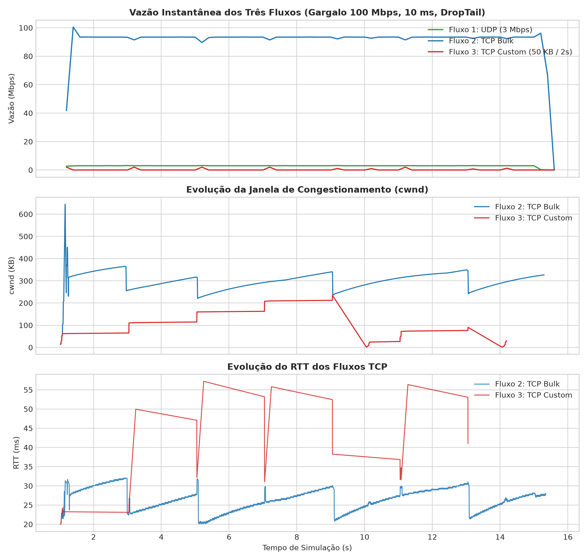

# Relatório — Atividade Prática NS-3

**Aluno:** Bruno Antonio dos Santos Bezerra  
**Login:** basb  
**Disciplina:** IF738 — Redes de Computadores  

---

## 1. Cenário Simulado e Desenvolvimento da Aplicação Customizada

A simulação foi implementada em C++ no **NS-3 (v3.41)** com topologia *Dumbbell* orientada ao tráfego de *downlink*: três servidores de origem (**Nó 3**, **Nó 4** e **Nó 5**) conectados ao roteador **R2**, interligado ao roteador **R1** por um link gargalo de **100 Mbps**, atraso de **10 ms** e fila **DropTail** pura (`ns3::DropTailQueue<Packet>`, capacidade de `100` pacotes, removendo o *queue disc* padrão `FqCoDel` via `TrafficControlHelper::Uninstall`), e três clientes de destino (**Nó 0**, **Nó 1** e **Nó 2**) conectados a **R1**. Todos os links de acesso foram configurados com **1 Gbps** e atraso de **0 ms**. Os três fluxos operam simultaneamente entre **1,0 s** e **15,0 s** (janela ativa de **14,0 s**):

- **Fluxo 1 (Nó 3 → Nó 0 — UDP):** `OnOffApplication` nativa sobre `UdpSocketFactory` a taxa constante de **3 Mbps** (`PacketSize = 1024 B`).
- **Fluxo 2 (Nó 4 → Nó 1 — TCP Bulk):** `BulkSendApplication` nativa sobre `TcpSocketFactory` com envio contínuo ilimitado (`MaxBytes = 0`).
- **Fluxo 3 (Nó 5 → Nó 2 — TCP Customizado):** Implementado na classe `CustomTcpApp` (arquivos `custom-tcp-app.h` e `custom-tcp-app.cc`), herdando diretamente de `ns3::Application`. Em `StartApplication()`, a aplicação instancia um socket TCP (`TcpSocketFactory`), registra *callbacks* de conexão (`SetConnectCallback`) e de disponibilidade de buffer de transmissão (`SetSendCallback`), e inicia a conexão com o nó destino. Ao estabelecer a conexão, `StartBlockTransfer()` inicia a transmissão de um bloco exato de **50.000 Bytes** por meio do método `SendChunk()`, que respeita dinamicamente o espaço livre do buffer TCP (`GetTxAvailable()`). Assim que todos os 50.000 Bytes do bloco são entregues ao socket, a aplicação agenda obrigatoriamente a próxima transferência após uma pausa exata de **2,0 segundos** com `Simulator::Schedule(Seconds(2.0), &CustomTcpApp::StartBlockTransfer, this)`. O ciclo se repete até `StopApplication()` em `15,0 s`, quando qualquer evento pendente é cancelado (`Simulator::Cancel`) e o socket é fechado.

---

## 2. Resultados Obtidos

| Métrica | Fluxo 1 (UDP 3 Mbps) | Fluxo 2 (TCP Bulk) | Fluxo 3 (TCP Custom) |
| :--- | :---: | :---: | :---: |
| **Vazão Média (Aplicação / 14 s)** | 2,9965 Mbps | 94,9195 Mbps | 0,2000 Mbps |
| **Total Recebido (`PacketSink`)** | 5.243.904 B | 166.109.184 B | 350.000 B (7 blocos) |
| **Atraso Médio Unidirecional (Downlink)** | 16,19 ms | 16,29 ms | 17,07 ms |
| **RTT Médio (`TcpSocketBase::RTT`)** | ~26,2 ms *(estimado)* | 26,32 ms | 33,86 ms |
| **cwnd (Média / Máxima)** | N/A (UDP) | 338,15 KB / 644,81 KB | 86,76 KB / 234,73 KB |
| **Pacotes Perdidos no Fluxo** | 4 / 5.126 (0,08%) | 259 / 114.986 (0,23%) | 0 / 249 (0,00%) |

- **Gargalo DropTail (R2 → R1):** `120.090` pacotes enfileirados, `263` pacotes descartados (`259` do TCP Bulk + `4` do UDP) e **Taxa de Descarte (Drop Rate) de 0,2185%**.

---

## 3. Análise dos Resultados

A competição pelo link gargalo de 100 Mbps evidencia claramente o contraste entre os três perfis de transporte. O **Fluxo 1 (UDP)** manteve vazão constante de **2,9965 Mbps** (~3% do link), praticamente insensível ao congestionamento por não possuir controle de taxa, sofrendo apenas 4 descartes pontuais quando a fila encheu. O **Fluxo 2 (TCP Bulk)** absorveu de forma agressiva quase toda a capacidade residual, alcançando **94,92 Mbps** de vazão útil média; sua janela de congestionamento (**cwnd**) cresceu até o pico de **644,81 KB** (média de **338,15 KB**), preenchendo repetidamente a fila DropTail de 100 pacotes e induzindo oscilações clássicas de redução da janela sempre que ocorriam descartes — respondendo por 259 dos 263 descartes totais do gargalo (**Drop Rate global de 0,2185%**). Esse enfileiramento contínuo elevou o atraso unidirecional no downlink de 10 ms (propagação pura) para cerca de **16,2–17,1 ms** em todos os fluxos, levando o **RTT médio do TCP Bulk** a **26,32 ms** (enquanto os ACKs no sentido reverso trafegaram sem fila, em 10,01 ms). Já o **Fluxo 3 (TCP Customizado)** completou exatamente **7 ciclos** de envio de 50.000 Bytes (`350.000 Bytes` totais, vazão média de **0,2000 Mbps**) sem nenhuma perda de pacote e com **cwnd** substancialmente menor (média de **86,76 KB**, pico de **234,73 KB**), pois sua transmissão limitada por aplicação em rajadas espaçadas de 2,0 s o impede de saturar o enlace; ainda assim, apresentou **RTT médio mais elevado (33,86 ms)** por iniciar cada rajada contra a fila DropTail já mantida ocupada pelo tráfego agressivo do TCP Bulk.
